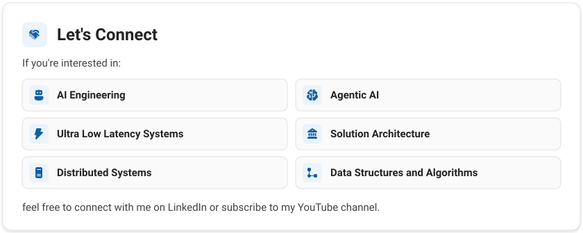

<!-- Styled with the Microsoft Fluent 2 design language. Edit content in scripts/build_assets.py, then run: python3 scripts/build_assets.py -->

<picture><source media="(prefers-color-scheme: dark)" srcset="./assets/intro-dark.svg"></picture>

<picture><source media="(prefers-color-scheme: dark)" srcset="./assets/connect-heading-dark.svg"></picture>

<a href="https://www.linkedin.com/in/joyrana/"><picture><source media="(prefers-color-scheme: dark)" srcset="./assets/link-linkedin-dark.svg"></picture></a>
<a href="https://joyrana.in"><picture><source media="(prefers-color-scheme: dark)" srcset="./assets/link-website-dark.svg"></picture></a>
<a href="https://joyrana-dev.medium.com/"><picture><source media="(prefers-color-scheme: dark)" srcset="./assets/link-medium-dark.svg"></picture></a>
<a href="https://www.youtube.com/@MrJoyRana"><picture><source media="(prefers-color-scheme: dark)" srcset="./assets/link-youtube-dark.svg"></picture></a>
<a href="https://github.com/joyrana"><picture><source media="(prefers-color-scheme: dark)" srcset="./assets/link-github-dark.svg"></picture></a>

<picture><source media="(prefers-color-scheme: dark)" srcset="./assets/lets-connect-dark.svg"></picture>

<picture><source media="(prefers-color-scheme: dark)" srcset="./assets/star-dark.svg"></picture>
