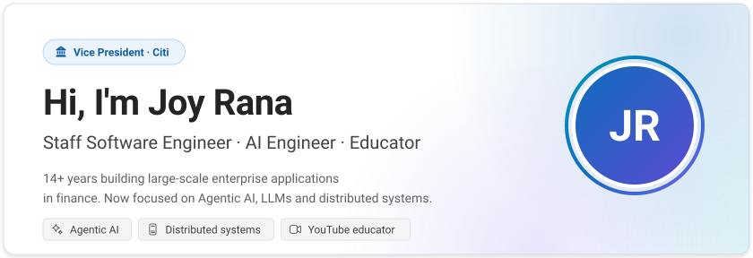
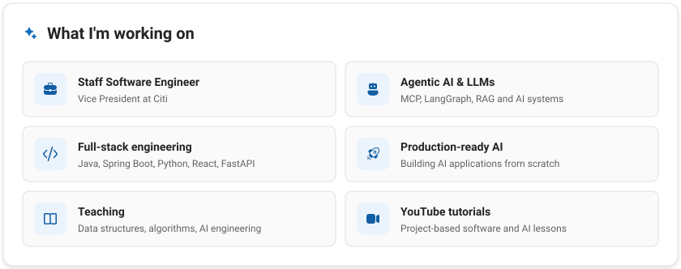
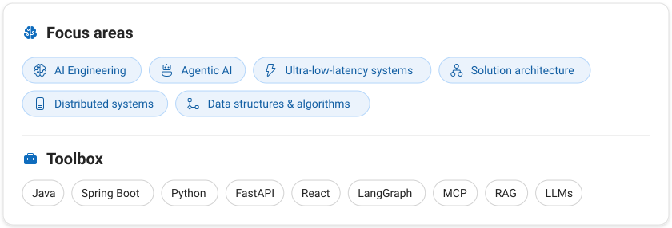

<!-- Visuals use the Microsoft Fluent 2 design language. Regenerate with: python3 scripts/build_assets.py -->

<picture>
  <source media="(prefers-color-scheme: dark)" srcset="./assets/hero-dark.svg">
  
</picture>

 

<picture>
  <source media="(prefers-color-scheme: dark)" srcset="./assets/now-dark.svg">
  
</picture>

 

<picture>
  <source media="(prefers-color-scheme: dark)" srcset="./assets/focus-dark.svg">
  
</picture>

 

<a href="https://www.linkedin.com/in/joyrana/"><picture><source media="(prefers-color-scheme: dark)" srcset="./assets/btn-linkedin-dark.svg"></picture></a>
<a href="https://www.youtube.com/@MrJoyRana"><picture><source media="(prefers-color-scheme: dark)" srcset="./assets/btn-youtube-dark.svg"></picture></a>
<a href="https://joyrana.in"><picture><source media="(prefers-color-scheme: dark)" srcset="./assets/btn-website-dark.svg"></picture></a>
<a href="https://joyrana-dev.medium.com/"><picture><source media="(prefers-color-scheme: dark)" srcset="./assets/btn-medium-dark.svg"></picture></a>

Into AI engineering, agentic AI, low-latency or distributed systems? Let's connect on LinkedIn or subscribe on YouTube — and if my projects help you, a ⭐ is always appreciated.
